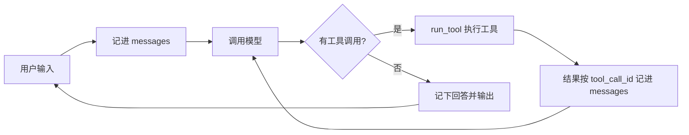

# Job Agent：日本 AI 岗位求职助手

一个基于大模型工具调用（function calling）的命令行求职助手。用户用自然语言提问，助手自己决定调用哪些工具来搜索岗位、查看详情、管理求职记录，并记住用户的日语等级和工作年限。

> 本项目是学习 AI Agent 开发时从零搭建的，重点不在功能多，而在于把 agent 的核心结构、可靠性设计和评测方法做扎实。岗位数据为虚构示例。

## 功能

- **岗位搜索**：按日语等级（JLPT）和工作年限筛选，同时说明不能申请的岗位及原因
- **假设查询**：回答"如果我考到 N2，能多投哪些岗位？"，用假设条件查询但不改动档案
- **岗位详情**：公司、地点、技能要求、是否远程等
- **求职记录**：添加、查看、修改投递状态（想投 / 已投递 / 面试中 / 已拒绝 / 已录取），永久保存
- **用户档案**：从对话中识别用户的日语等级和工作年限并保存，重启后依然记得
- **多轮对话**：支持追问、反问和上下文理解

## 对话示例

```
你: 我的ai new grad收到面试通知了
 [第1趟] 调用 update_application_status {"job_id": 1, "status": "面试中"}
 ! 助手想执行 update_application_status {'job_id': 1, 'status': '面试中'}, 确认吗？(y/n) y

助手:  完成！我已经将"AI New Grad"职位的状态从"已投递"更新为"面试中"。
```

用户没有说"修改状态"，助手从日常说法中理解了意图；修改已有数据前会先请用户确认。

## 架构



三层结构：

| 层 | 函数 | 职责 |
| --- | --- | --- |
| 对话循环 | `chat()` | 读取用户输入，维护整场对话的消息历史 |
| 工具循环 | `run_turn()` | 反复调用模型，直到模型不再请求工具（最多 `max_steps` 次） |
| 工具执行 | `run_tool()` | 查找并执行函数，处理确认和异常 |

分工原则：**模型负责理解与表达**（判断意图、把自然语言转成参数、整理结果），**代码负责确定性的计算与执行**（岗位是否符合条件由 `search_jobs` 计算，不交给模型判断）。新增能力只需添加工具，主流程不用改。

## 工具一览

| 工具 | 作用 | 类型 | 需要用户确认 |
| --- | --- | --- | --- |
| `search_jobs` | 按条件筛选岗位；不传条件时返回全部岗位 | 只读 | 否 |
| `get_job_detail` | 查询单个岗位详情 | 只读 | 否 |
| `list_applications` | 查看求职记录 | 只读 | 否 |
| `save_profile` | 保存用户的日语等级、工作年限 | 写入 | 否 |
| `add_application` | 新增求职记录 | 写入 | 是 |
| `update_application_status` | 修改已有记录的状态 | 写入（覆盖） | 是 |

## 关键设计决策

**1. 双重保险：软约束 + 硬约束**

参数用 `enum` 和说明文字在源头约束模型；函数内部再校验一次，`run_tool` 用 `try/except` 把错误以文字形式交还模型，让它自行纠正。实验中去掉 `enum` 后，模型第一次传入"中级"得到错误提示，第二次自动改为 "N3"，程序没有中断。

**2. 错误信息写给模型看**

错误提示不只说"失败"，还写明合法取值和下一步该做什么（例如"职位 id 应该来自 search_jobs"、"记录不存在请改用 add_application"）。"已存在"返回 `ok: True` 并注明无需重试，避免模型把它当成失败反复调用。

**3. 有后果的操作：确认 + 幂等**

写入类工具执行前由代码要求用户确认（`NEEDS_CONFIRM`），而不是只靠 prompt 约束。`add_application` 先检查是否已存在，重复调用也只会有一条记录。确认弹窗容易让用户"不看就点同意"，所以幂等这一层更关键。

**4. 记忆分三层**

| 记忆 | 实现 | 生命周期 |
| --- | --- | --- |
| 短期 | `messages` 消息历史 | 本次运行 |
| 长期 | `profile.json`、`applications.json` | 永久 |
| 注入 | 每轮把档案写进 system prompt | 每轮刷新 |

写入由模型判断（从对话中识别并调用 `save_profile`），读取由代码保证（每轮注入，不依赖模型记得去查）。

**5. 按轮截断上下文**

消息历史会越来越长，增加费用和延迟。`trim_messages` 只保留最近几轮，并且从 `user` 消息处截断，保证每个工具调用和它的结果始终成对，避免接口因缺少对应调用而报错。关键用户信息已在长期记忆里，截断不会丢失。

**6. 区分事实与假设**

"我考过 N2 了"会更新档案；"如果我考到 N2"只用假设条件查询，档案不变。工具说明、参数说明和 system prompt 对此口径一致。

**7. 引导并行调用**

互不依赖的查询（如同时查 N3 和 N2 的结果）要求在同一次回复中发起，减少一轮模型调用；有依赖的调用（先搜索拿到 id 再查详情）则按顺序进行。

## 评测

`eval.py` 用固定的测试用例对 agent 进行多次运行，自动检查模型调用了哪些工具、参数是否正确，统计通过率。

- 测试时把数据文件切换到 `test_data/`，并自动拒绝所有写入确认，不影响真实数据
- 每次运行前按用例重置档案和求职记录，用例之间互相独立
- 由于模型输出有随机性，每个用例运行 N 次，看通过率而不是单次结果

| 用例 | 检查内容 | 通过率（N=3） |
| --- | --- |----------|
| 问公司不追问条件 | 只问岗位信息时，不询问用户条件，不写入数据 | 3/3      |
| 假设不存档 | 用假设等级（N2）查询，且不更新档案 | 3/3      |
| 事实要存档 | 用户陈述真实变化时更新档案 | 3/3      |
| 不主动记录求职 | 查询岗位时不擅自添加求职记录 | 3/3      |
| 日常说法改状态 | "收到面试通知了" → 将状态改为"面试中" | 3/3      |

**一次评测驱动的修复**

最初"假设不存档"用例只检查"是否调用了 search_jobs"，结果 3/3 通过。把检查收紧到参数后，通过率降为 **0/3**：模型要么不传条件、拿全部岗位后自己比较，要么仍用当前等级查询，从不使用假设等级。

原因是多处指示在暗示"只能填用户本人的等级"：参数名 `my_japanese`、参数说明"求职者的日语水平"、档案提示"直接使用这些信息"；关于假设只写了"不要保存"，没写"该怎么查"。统一工具说明、参数说明和 system prompt 的口径后恢复通过，其余用例未受影响。

结论：测试通过不等于行为正确，检查条件要覆盖到参数层面；给模型的指示要写清"该怎么做"，并且各处口径一致。

## 开发中遇到的问题

| 问题 | 原因 | 解决 |
| --- | --- | --- |
| 模型声称"已记录"，文件却没生成 | 函数缩进错误，追加和保存写进了循环内部 | 修正缩进；日志同时打印工具调用和返回结果，以日志而非模型的说法为准 |
| 模型对同一写入操作重复调用 | "已存在"被返回为失败 | 返回 `ok: True` 并注明无需重试；防重复保证数据不会重复 |
| 新工具被调用但不执行 | 说明书已添加，函数映射表漏登记 | 启动时用 `assert` 自动检查两者是否一致 |
| 模型回答了数据中不存在的岗位 | 未调用工具，凭训练知识作答 | 在 system prompt 和工具说明中明确"唯一数据来源"，降低 `temperature`，用多次运行统计验证 |
| 输出中混入模型内部标记、续写 system prompt | 所用模型在该接口上输出不稳定 | 判断工具调用只看结构化字段 `tool_calls`，不解析文本内容 |

## 技术栈

- Python 3
- OpenAI Python SDK（调用 Amazon Bedrock 的 OpenAI 兼容接口）
- 模型：DeepSeek V3.2（通过 Amazon Bedrock）
- 数据存储：JSON 文件

工具定义采用 OpenAI function calling 格式，更换为其他兼容该格式的模型时，通常只需修改 `MODEL` 和接口地址。

## 运行方法

```bash
git clone https://github.com/rocky-xiaoban/job_finding_agent.git
cd <仓库名>
pip install -r requirements.txt
```

复制 `config.example.py` 为 `config.py`，填入你的 Amazon Bedrock API key：

```python
AWS_BEARER_TOKEN_BEDROCK = "your-bedrock-api-key"
```

启动助手：

```bash
python agent.py
```

运行评测：

```bash
python eval.py
```

## 项目结构

```
.
├── agent.py            # 模型调用、system prompt、工具循环、对话循环
├── tools.py            # 岗位数据、工具函数、工具说明、函数映射表
├── eval.py             # 自动化评测
├── config.example.py   # 配置示例（复制为 config.py 使用）
├── requirements.txt
└── README.md
```

运行后会生成 `profile.json`、`applications.json`（用户数据）和 `test_data/`（评测数据），均已在 `.gitignore` 中忽略。

## 局限与后续计划

- 岗位数据为 3 条虚构示例，计划改为从文件或外部数据源读取
- 评测目前只检查工具调用，尚未评估回答质量
- 计划加入 Web 界面（Streamlit），并显示 agent 的工具调用过程
- 计划加入 RAG：上传简历，与岗位描述做语义匹配并给出匹配理由
